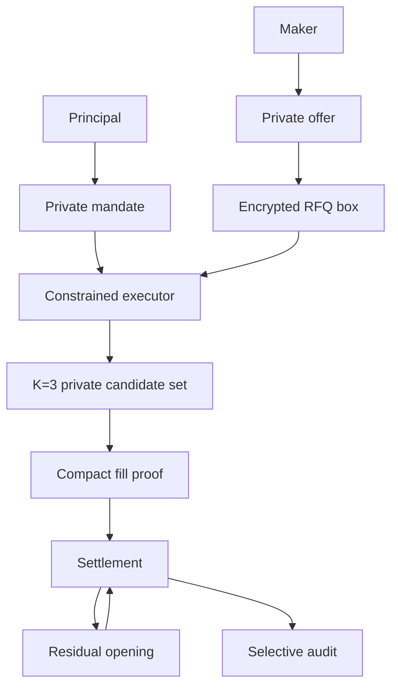
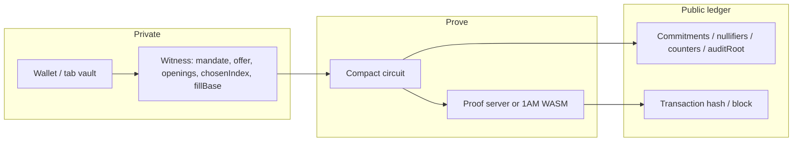
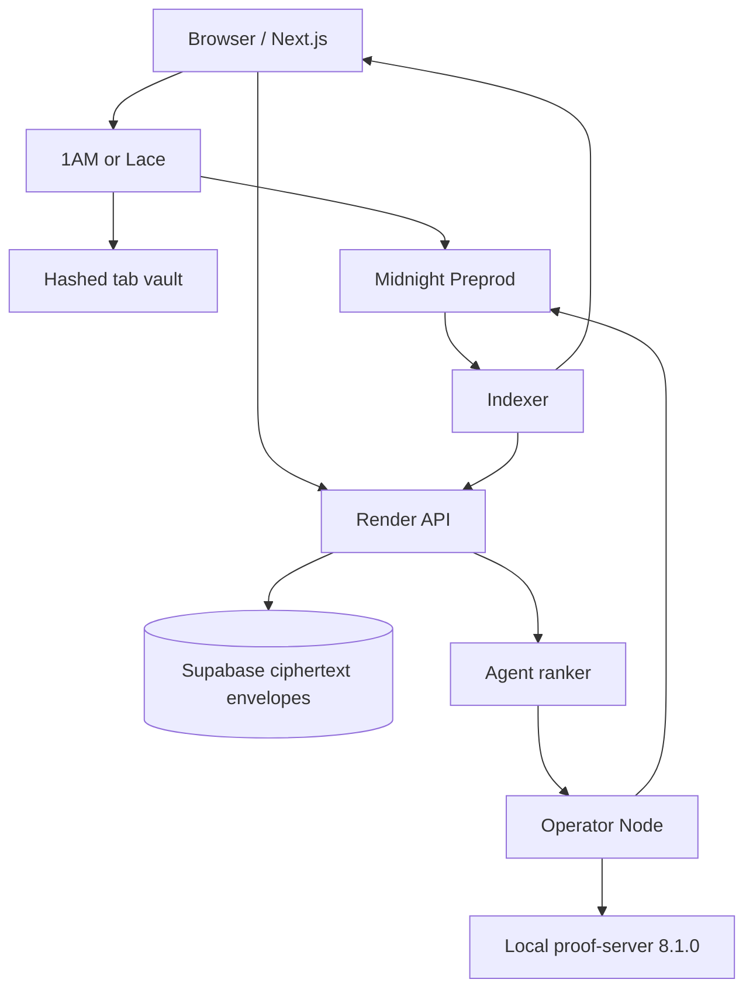
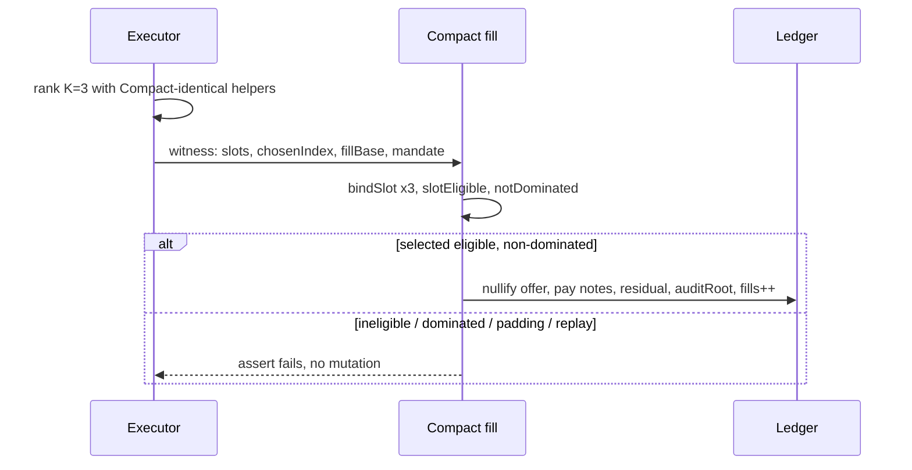
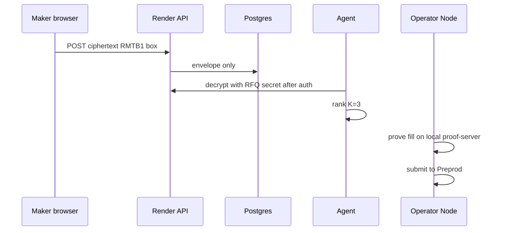
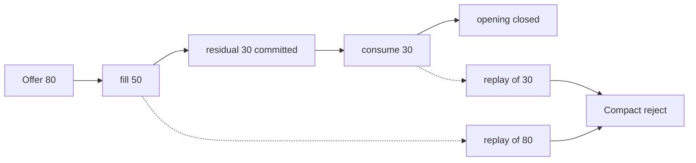
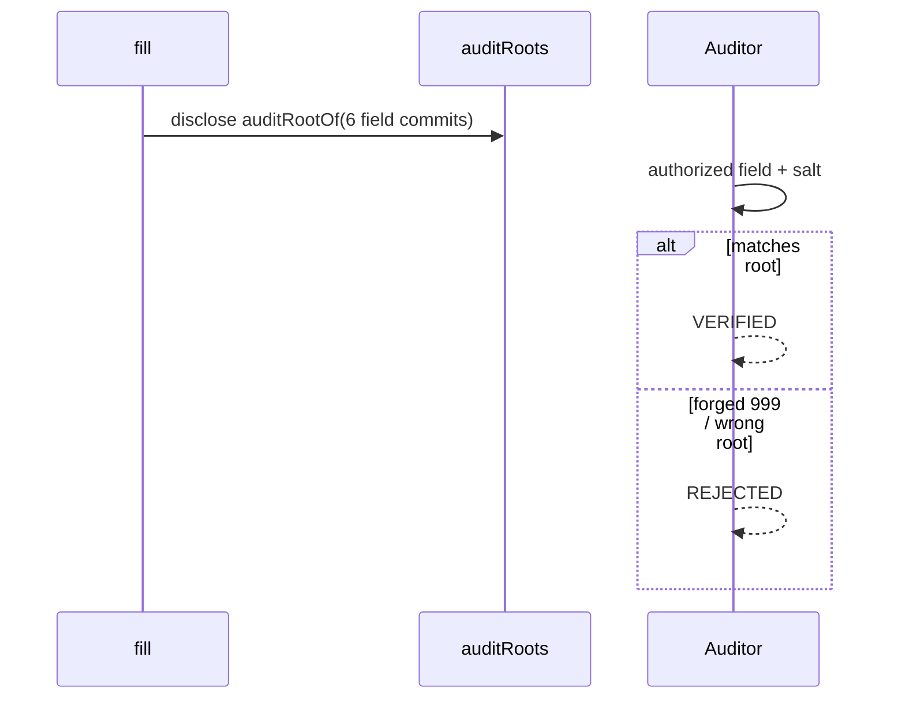
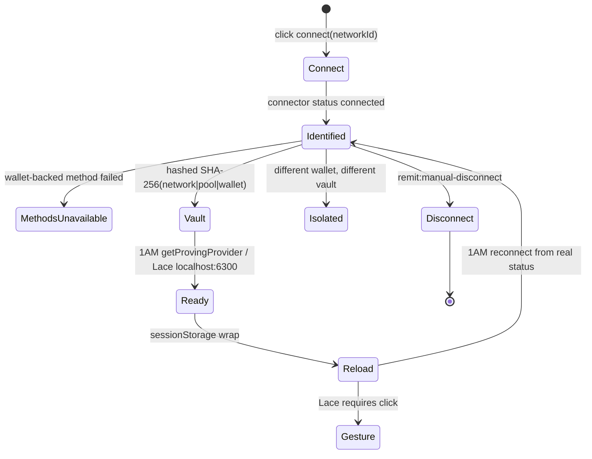
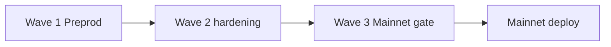

# REMIT

**Provable spending limits for autonomous purchasing agents — the agent can choose, it cannot exceed.**

*The agent can choose. It cannot exceed.*


## Verdict first

Companies are deploying autonomous purchasing agents, and the first question every compliance owner asks is the same: **prove it cannot exceed its limits.** REMIT is the constraint layer that answers it — demonstrated through a mandate-bound execution venue on Midnight:

- a **mandate-bound executor** operating inside committed spending bounds,
- **sealed RFQ matching** that proves bounds-compliance of every fill,
- **nullifier-bound selective disclosure** so a named auditor can check exactly one fact without ever seeing the book.

**Proven (shipped, verifiable today):** the mandate-bound executor and sealed matching on Midnight Preprod · the `discloseField` circuit, full-ZK compiled on the pinned Compact 0.31.1 toolchain with simulator + refusal tests green (CI green) · 202+ simulator tests on compiled artifacts · refusal paths (over-cap, bad price, replay, forged disclosure) enforced by Compact, not by UI.

**Not proven (disclosed, not closed):** that the *choice* was the best available — the executor may pick the worst in-bounds quote and the proof still verifies. Choice steering is **trusted, not proven**; best-execution binding is a Wave-3 research item. Nothing here claims procurement fairness, fair award, or unriggability — see the eight non-claims in [docs/HONEST-LIMITS.md](docs/HONEST-LIMITS.md).

**Not claimed, anywhere:** no users, pilots, LOIs, or partnerships. The 2026 regulatory context below is context for the problem, never an endorsement of this project.

## Contents

1. [Privacy — what is secret, from whom](#privacy--what-is-secret-from-whom)
2. [What REMIT is](#what-remit-is)
3. [On-chain proofs](#on-chain-proofs)
4. [Why REMIT exists](#why-remit-exists)
5. [Core idea](#core-idea)
6. [Architecture](#system-architecture)
7. [Production persistence](#production-persistence)
8. [Private vs public state](#private-vs-public-state)
9. [Compact contracts](#compact-contracts)
10. [MBBE](#mbbe-k3)
11. [RFQ](#rfq)
12. [Residual execution](#residual-lifecycle)
13. [Selective audit](#selective-audit)
14. [Wallet architecture](#wallet-architecture)
15. [Proof architecture](#proof-architecture)
16. [Preprod evidence](#preprod-evidence)
17. [Tests](#tests)
18. [Judge / Local Contract Compilation](#judge--local-contract-compilation)
19. [Judge: run REMIT locally](#judge-run-remit-locally)
20. [Judge CLI](#one-command-judge-evidence)
21. [Security and privacy](#security-verification)
22. [DECK-NARRATIVE](#deck-narrative)
23. [Honest ledger — real vs plan](#honest-ledger--real-vs-plan)
24. [Wave 1 / Wave 2 / Wave 3](#wave-1---proven-foundation)
25. [What changed since Wave 1](#what-changed-since-wave-1)

## Privacy — what is secret, from whom

When competing dealers learn your flow, limits, and urgency, they shade their quotes — you pay wider spreads on every fill. On real weekly flow, leaked limits cost a desk basis points per fill, paid out of a real P&L, every week. REMIT's privacy exists so the other side of the quote can't price your desperation.

| Stays secret | Secret FROM WHOM | Why |
|---|---|---|
| Your limits: max price, max size, budget left, expiry, who you'll trade with | Everyone — makers, other desks, the public; the executor sees only that a bound exists, never its value | If anyone sees these, they trade against you. Your limits ARE your strategy. |
| The maker's price and size | Everyone except the executor's ranking step | Seeing this leaks their book. Nobody quotes honestly if their book is public. |
| Who won the deal, and at what size | Everyone except the two counterparties | Reveals the winner and their pricing power. |
| Which agent is allowed to act for you | Everyone (binding is by a secret the public commitment never reveals) | If someone can impersonate your agent, your limits are fiction. |

| Goes public | Why |
|---|---|
| Tamper-evident receipts (proves no deal was counted twice) | Everyone can verify the books balance without seeing a single price. |
| One fact opened to YOUR named auditor (their key only — ciphertext on the ledger) | Compliance gets exactly what it needs, nothing else. The world learns a disclosure happened and to whom — the field value stays encrypted. |
| That a transaction happened, and when | The chain has to see the event to timestamp it. |

**The one question every buyer asks:** *If the agent can't see my limits, how does it stay inside them? And if it can see them, what's actually secret?*

> The executor sees rankings and encrypted quote boxes — enough to pick, never your limit values. The circuit checks the pick against your committed limits and rejects anything outside them. You don't trust the agent's honesty about compliance; you verify it on the ledger.

**Settlement note:** Preprod fills settle in REMIT-Q — a testnet-only faucet token, explicitly NOT a stablecoin, NOT redeemable. The product's settlement leg is asset-agnostic; no token economics are claimed.

The technical privacy boundary (witnesses, commitments, nullifiers, circuits) lives in the sections below and in [docs/THREAT-MODEL.md](docs/THREAT-MODEL.md). Nobody else proved an agent stayed inside someone else's limits and let an auditor check one fact without seeing the book.

## What REMIT is

REMIT is a **constraint layer for autonomous purchasing agents** — demonstrated through a mandate-bound RFQ venue on Midnight. The product is the constraint, not the venue:

- **Mandate-bound executor.** A principal seals a spending mandate (max notional, price bounds, counterparty set, expiry) as a private commitment. The purchasing agent negotiates freely *inside* it; Compact will not settle a fill outside it. The mandate never leaves the firm's private state, and anyone verifies compliance from commitments alone.
- **Sealed RFQ matching.** Counterparties quote into sealed boxes. The executor ranks a private K=3 candidate set, and the circuit proves the fill was best-of-K *among sealed candidates in this transaction* and inside the mandate. When competing dealers learn your flow, limits, and urgency, they shade their quotes — you pay wider spreads on every fill. On real weekly flow, leaked limits cost a desk basis points per fill, paid out of a real P&L, every week.
- **Nullifier-bound selective disclosure.** The `discloseField` circuit (`CONTRACT/src/remit_quote.compact`, full-ZK compiled, CI green) encrypts exactly one mandate field in-circuit to the auditor's key, binds it by recomputation to the on-chain mandate commitment, and writes a disclosure nullifier that kills replay. The compliance owner checks one fact — e.g. the executed notional — without seeing the book; the world learns only that a disclosure happened, to whom, and of which field.

The RFQ desk is the **reference integration and the demo venue** — the concrete setting where the constraint layer is exercised end to end. Any agent framework that can commit limits, submit a fill, and verify a proof can integrate with the same layer; the venue is not the product.

Wave 1 is live on Midnight Preprod (`protocolVersion` 1000000, ledger 8). Wave 2 hardens the same protocol. Wave 3 targets Mainnet after an explicit capability gate.

Pinned stack (do not bump for this pool): Compact **0.31.1** / language **0.23** / midnight-js **4.1.1** / wallet-sdk **1.2.0** / DApp Connector **4.0.1** / proof-server **8.1.0** / indexer **4.3.3-hotfix**.

Hosted UI: https://remit-front.vercel.app  
Hosted API: https://remit-api-node.onrender.com  
Source: this repository. License: Apache-2.0.

---

## On-chain proofs

Every claim below is a Compact transaction on Midnight Preprod (`protocolVersion` 1000000). Open a link. The explorer is the settlement record.

Pool `01bebd52ad1b243b390c853bbc2c1588d1cf0f487934d54d79f8a590505c105e` · Quote `7559e38693725dafef73486f2ee3aa30ee0b5b543e22d0aa5ad7303c37b55e3f` · `auditRoot` `1bbc1cc2aa2cd83de56cb8ea15ec5dfb8dd071cf2fb305980416ed726b81a694`

| What settled | Block | Explorer |
|---|---|---|
| Quote REMIT-Q deployed | 2538374 | [04800c4c…08008](https://preprod.midnightexplorer.com/transactions/0x04800c4ca43dd572d77ca1e5cf604702c609ff091ecb567f942ff15e17c08008) |
| MBBE K=3 pool deployed | 2541620 | [55224e41…61798a](https://preprod.midnightexplorer.com/transactions/0x55224e41e1b68f5cc65286f19e7269b199563158806fc5ae03fe9f536c61798a) |
| Padding cannot win | 2541757 | [8fac31ab…b92e55](https://preprod.midnightexplorer.com/transactions/0x8fac31ab4a7b76e91f8da95d8bfd0099f0a754daa4641d571dcdd45b59b92e55) |
| Live K=3 fill | 2542039 | [12306cbe…38cbd20](https://preprod.midnightexplorer.com/transactions/0x12306cbe24823f1ac39f0a1db3ee23214cc84d44cb8014b1d2f84d67838cbd20) |
| Mandate created | 2541972 | [308c7b2c…010749](https://preprod.midnightexplorer.com/transactions/0x308c7b2c57a8ab9aeefea4a1c243f5da056e6b5f4dbd4dc234cdb84aa1010749) |
| Private maker offer | 2548791 | [c303ec61…5265b2](https://preprod.midnightexplorer.com/transactions/0xc303ec61c09d406acfbec24915dd83c0546c1e833329a3e6a2f7de53b15265b2) |
| RFQ fill 50 of 80 | 2549944 | [5a1200f5…16f00a](https://preprod.midnightexplorer.com/transactions/0x5a1200f5869cb60c81f9ebcb649da45fb47c563bc245c362d36665597b16f00a) |
| Residual 30 consumed | 2550168 | [5f1203cf…12b99f](https://preprod.midnightexplorer.com/transactions/0x5f1203cf9cdde32192f4a2cdce275ff34529b19bbe24644f6014b1c24f12b99f) |
| Compact withdraw | 2550510 | [999e2b5b…490fce5](https://preprod.midnightexplorer.com/transactions/0x999e2b5b3a32c7537ebba3ecb9afd7bce77f8ff205f97e361c2be5e35490fce5) |
| Chrome createMandate | 2551299 | [5172ab71…36df8fa9](https://preprod.midnightexplorer.com/transactions/0x5172ab712e2cb39e5f455dd8cec609765d6fe2225ca0b0e97412cfc436df8fa9) |
| Chrome revokeMandate | 2551669 | [8ae27d7a…1882f49](https://preprod.midnightexplorer.com/transactions/0x8ae27d7a3930c284a410198234d97ad110f0668af29cf89c42091b3b51882f49) |
| Chrome deposit | 2551700 | [cdb04c15…05ff2d](https://preprod.midnightexplorer.com/transactions/0xcdb04c15462fad79bcd851ec39604bae32ef3b8f2463eb44aea7e7365c05ff2d) |

Public JSON (hashes only, no openings): [hosted `/evidence`](https://remit-api-node.onrender.com/evidence) · [hosted `/chain`](https://remit-api-node.onrender.com/chain) · committed copy `apps/api/preprod-evidence.json`.

> An agent can choose. It cannot exceed the mandate. These transactions are how you check.

---

## Why REMIT exists

In 2026, autonomous agents started spending real money — and on the payment rails, your agent is you. The question nobody could answer: **prove it stayed inside its limits.**

The governance fear is documented, not speculative:

- Japan's Digital Agency (June 2026) revised its generative-AI procurement guidance and brought **AI agents** inside the scope of reporting to its advanced-AI advisory structure — AI agents in procurement are now a governed category in Japan's public sector. ([dig.watch](https://dig.watch/updates/japan-minister-measures-aienabled-cyberattacks))
- Japan's FSA made on-chain finance its top 2026 priority and "will evaluate necessary supervision adjustments as adoption grows" for AI technologies including AI agents. ([published 2026-09-17](https://news.nbtc.finance/japans-fsa-makes-on-chain-finance-policy-its-top-2026-priority/))
- The precise control-parameter shape already exists in industry guidance for agentic payment systems in Japan: **position limits, counterparty exposure caps, single-instruction value thresholds that the agents cannot exceed without triggering a human review gate** — described as "the design features that make the system acceptable to the FSA," not as restrictions. ([tfsfventures](https://www.tfsfventures.com/blog/the-opportunity-in-agent-to-agent-payments-for-trading-in-japan))
- Eleven 2026 industry documents (GLEIF, Worldline, CBA, J.P. Morgan, Citi) call for mandate/scope controls — amount, payee, time — checked at the moment of payment; J.P. Morgan's 2026 Payments Outlook describes agents "transacting autonomously within defined, narrow parameters," with humans keeping the final say on treasury.

None of this endorses REMIT. It establishes that the problem — provable limits an agent cannot exceed — is a real, current, 2026 enterprise and regulatory concern, not a invented one.

REMIT makes the policy itself the object of cryptography:

- The **principal** authorizes an executor inside a private mandate.
- **Makers** quote private offers into an encrypted RFQ path.
- The **executor** may rank and select. Compact will not settle a fill that violates the mandate.
- The **public ledger** records commitments, nullifiers, counters, and an `auditRoot`. It does not store openings, prices, `chosenIndex`, or `fillBase`.

The agent is constrained execution infrastructure, not a chatbot and not settlement authority. Model output never authorizes a fill. The compliance story in one line: **position limits, exposure caps, value thresholds — the control parameters regulators expect agents to carry — become proofs, not promises.**

---

## Core idea



1. Principal seals a **Mandate** (asset, side, cap, limit, remaining, `cpRoot`, executor key, expiry).
2. Maker seals an **Offer** (side, size, price as base/quote, minFill, expiry) and optionally boxes it as RMTB1.
3. Executor receives openings it is given, ranks a **K=3** private book, and proves `fill(nowBound)`.
4. Compact consumes the selected offer, pays both sides as notes, inserts a residual offer if leftover size remains, writes `auditRoot`, increments `fills`.
5. Principal may **revoke**. Owner may **withdraw** leftover notes. Auditor may verify one authorized field against `auditRoot`.

---

## What Midnight protects

Midnight is a dual-ledger system. Compact circuits run locally over private witnesses and disclose a minimum public transcript plus a ZK proof.



Official Midnight guidance: the proof server sees witnesses in the clear. REMIT therefore proves user circuits in the wallet (1AM `getProvingProvider`) or on an operator-controlled local proof-server 8.1.0. Render does not receive fill witnesses.

---

## System architecture



Where plaintext exists:

| Location | Plaintext | Encrypted / committed |
|---|---|---|
| Browser tab vault | Mandate/offer openings after unlock | AES wrap; storage key is `SHA-256(network\|pool\|wallet)` |
| 1AM in-tab prove | Witness during prove | Proof only on the wire to Midnight |
| Operator Node + local proof-server | Fill witness during prove | Not on Render |
| Render API | Public hashes, ciphertext boxes | RMTB1 envelopes; no openings in JSON |
| Postgres | Ciphertext, owner binding | RLS deny-all; no service role in the browser |
| Ledger | Amounts at unshielded deposit/withdraw; commitments, nullifiers, counters | Openings never stored |

---

## Production persistence

```
Browser → Render API → Postgres (transaction-mode pooler) → Midnight / Indexer
```

The API stores ciphertext envelopes (`RMTI1` snapshots and already-boxed `RMTB1` RFQ/mandate rows) plus allowed public metadata. It does not store mandate plaintext, offer prices or sizes, `chosenIndex`, `fillBase`, or private fill witnesses.

Server-only secrets (`.env.preprod.local` and Render env — never `NEXT_PUBLIC_` / `VITE_`, never committed):

- `DATABASE_URL` — transaction-mode pooler, port **6543**, `pgbouncer=true`. Runtime reads/writes. One process uses one connection (`max: 1`).
- `DIRECT_URL` — session-mode pooler, port **5432**. Schema / `npm run persist:migrate` only.

```bash
npm run persist:migrate
```

creates `remit_envelopes` with RLS enabled and deny-all policies for `anon` / `authenticated`. The table owner is the server role, so the API still enforces authorization in HTTP (public routes never list boxes; `GET /inbox` is Bearer-admin). Runtime `GET /health` does not run DDL. Persist pings are cached for 60 seconds so Render health checks are not a Postgres round-trip on every probe.

`npm run persist:inspect` prints redacted sizes and policy names only.

---

## Private vs public state

| Object | Private | Public | Boundary |
|---|---|---|---|
| Mandate | terms, `mandateData`, rand | `mandateCommitment`, revocation tag | openings never in JSON |
| Offer | price, size, maker, minFill | `offerCommitment`, offer nullifier | RFQ box is ciphertext |
| Fill | `chosenIndex`, `fillBase`, `fillQuote`, K-set | `fills++`, residual commit, `auditRoot` | Compact asserts; agent cannot override |
| Residual | leftover opening | new offer commitment | spent opening cannot replay |
| Audit | field openings | `auditRoot` | one-field verify; forged fails |
| Custody | note nonce, owner secret | unshielded amount at deposit/withdraw | amount is the unshielded boundary |
| Wallet | Bech32 address, wrap key | none in storage keys | hashed namespace |

---

## Protocol objects

- **Note** — private unshielded-backed pool note (`asset`, `amount`, `owner`).
- **Offer** — private quote (`side`, `baseAmount`, `quoteAmount`, `maker`, `payNonce`, `expiry`, `minFillBase`).
- **Mandate** — private policy (`principal`, `executor`, `side`, `maxFillBase`, limit, `cpRoot`, `expiry`, `mandateId`).
- **MandateState** — `{ mandateId, remaining }` committed separately so remaining can change without republishing the mandate.
- **Residual** — leftover offer after a partial fill (`baseAmount - fillBase`, derived `payNonce` / rand).
- **Nullifier** — spend tag for notes, offers, and mandate states.
- **AuditRoot** — `auditRootOf` over six field commitments (side, fillBase, fillQuote, principal, maker, mandateId).
- **Disclosure package** — one authorized field + salt + `auditRoot`; forged values fail `verifyDisclosure`.

---

## Compact contracts

`CONTRACT/src/remit_pool.compact` — pragma `>= 0.22 && <= 0.23`, toolchain **0.31.1**. Seven impure circuits. Do not add an eighth.

`CONTRACT/src/remit_quote.compact` — REMIT-Q faucet. Separate contract. No cross-contract calls.

### Pool circuits

| Circuit | Purpose | Private | Disclosed / public effect | Fails when |
|---|---|---|---|---|
| `deposit` | Mint a note from unshielded funds | owner secret, nonce | asset, amount (unshielded receive) | bad asset, zero amount |
| `withdraw` | Return note value to `withdrawTo()` | owner secret, note | asset, amount, recipient | wrong owner, insufficient note |
| `placeOffer` | Commit an offer, escrow size | `offerData`, rand, note | offer commitment, `openOffers++` | not maker, bad size, escrow too small |
| `cancelOffer` | Nullify unused offer, return escrow | offer, path | offer nullifier, `openOffers--` | not owner, already used |
| `createMandate` | Commit policy + remaining | `mandateData`, rand, note | mandate + state commitments, `activeMandates++` | not principal, empty escrow |
| `revokeMandate` | Kill mandate, return remaining | mandate + state openings | revocation tag, state nullifier, `activeMandates--` | not principal, already revoked |
| `fill` | Prove policy, settle, residual, audit | executor secret, mandate, K=3 book, `chosenIndex`, `fillBase` | offer nullifier, residual commit, notes, `auditRoot`, `fills++` | ineligible, dominated, replay, cap, price, budget, expiry, wrong executor |

### Quote circuits

| Circuit | Purpose |
|---|---|
| `quoteColor` | `tokenType("remit:quote", self)` |
| `claim` | Mint up to 1000 REMIT-Q per (caller, UTC-day). Not a stablecoin. |

---

## MBBE (K=3)

MBBE proves the candidate the executor chose from the **K=3 private openings** in its witness (`book()`) is eligible and non-dominated — every proven fill stays inside your committed limits. K only bounds the witness set: no fill can exceed the bounds, but ranking quality is never proven — only bounds-compliance.



Eligibility (simplified): live slot, opposite side, not expired, price inside limit, size inside cap and remaining, counterparty under `cpRoot` (or open), `minFill` respected unless filling the whole offer.

Padding: `live=false` cannot win. All-ineligible fails. An eligible slot dominated by another eligible slot fails `notDominated`. The executor cannot push a dominated candidate through without a failed proof — but among non-dominated slots it may choose the worst-priced in-bounds one; choice quality is not proven.

Wave 2 investigates encoding still more of the ranking predicate in-circuit. Wave 2 does not claim a global order book.

---

## RFQ



Public HTTP never lists openings. Admin `/inbox` is Bearer. Replay nonces reject duplicate boxes.

---

## Residual lifecycle



Verified on Preprod: fill 50/80 `5a1200f5…` block 2549944, residual 30 `5f1203cf…` block 2550168.

---

## Selective audit



Live head: `1bbc1cc2aa2cd83de56cb8ea15ec5dfb8dd071cf2fb305980416ed726b81a694`. Chrome auditor: fill amount 30 VERIFIED; forged 999 REJECTED.

**Wave 2 shipped this on-ledger:** the `discloseField` circuit (`CONTRACT/src/remit_quote.compact`, commit `efda26c`) recomputes the field commitment and the full `auditRootOf` in-circuit, discloses the root value + field commitment + public metadata (`fieldSelector`, `auditorKey`), and publishes an off-circuit RMTB1 sealed box holding `value ‖ salt` — the auditor decrypts, recomputes, compares. **Rename is final:** the v2 spec's `disclose` is a Compact 0.31.1 reserved keyword (parse-time hard error), so the circuit shipped as `discloseField`; the builtin `disclose(x)` calls inside `claim` are untouched. **Honest hybrid:** Compact 0.31.1 has no in-circuit encryption primitive, so the field is sealed OFF-circuit with the repo's real RMTB1 pattern (X25519 + XChaCha20-Poly1305) and passed in as opaque `sealedBox: Bytes<160>` — never plaintext on the transcript. In-circuit does authorization + binding + anti-replay. **Non-claim:** the pool's `auditRoots` is a `List<Bytes<32>>`, not a Merkle tree — no membership proof is claimed; root presence is off-chain-verifiable only (RPC read). The ledger-write boundary is the disclosure nullifier `persistentHash(pad(32,"remit:dnull"), commitment, auditorKey)` → new `disclosureNullifiers` set — it kills replayed disclosure *and* gives the circuit its `proof:false` boundary in one write. `fieldSelector`/`auditorKey` are public metadata: observers learn *which* field was opened *to whom* (the world learns a disclosure happened; the field value stays sealed). Full boundary spec: [docs/PRIVACY-BOUNDARY.md §4](docs/PRIVACY-BOUNDARY.md). Full-ZK artifacts (`.zkir`, `.verifier`, `.prover`) are committed under `CONTRACT/managed/remit_quote/`; simulator, refusal-path, and ciphertext≠plaintext regression tests live in `TESTS/unit/disclose-*.test.ts` and `TESTS/privacy/disclose-leak.test.ts`.

---

## Wallet architecture

Connector: DApp Connector **4.0.1**. `connect(networkId)` must run in the click handler with no prior await. Private vault keys are `SHA-256(network|pool|wallet)`. A different wallet is a different vault.

**Recommended Preprod / judge path: 1AM** (browser proving). Lace is an alternative wallet; a local proof-server may be required. Compact settlement is the same either way.

Connection and proving are different states:

| State | Meaning |
|---|---|
| **CONNECTED** | `connect(networkId)` resolved. |
| **CONNECTED / WALLET METHODS UNAVAILABLE** | Connector session exists, but wallet-backed methods (`getUnshieldedAddress`, balance, submit) are not ready. Compact is not attempted. |
| **PROOF SERVER REQUIRED** | Lace is connected; proving uses local proof-server 8.1.0 at `http://localhost:6300`. |
| **READY FOR PROVING** | 1AM: `getProvingProvider`. Lace: methods ready **and** local proof-server 8.1.0. |

### 1AM

- Recommended for Preprod / browser proving.
- Discovery via `window.midnight`, then `connect(networkId)` in the click.
- Circuit clicks re-bind `connect(networkId)` so in-tab `getProvingProvider` still works after reload.
- User circuits prove in the browser. Never asks for a seed.

### Lace

- Alternative wallet. Same `connect("preprod")` on the wallet-tile click.
- Compact proofs go to local proof-server **8.1.0** at `http://localhost:6300` (`npm run proof:up`). Witnesses stay local, never Render.
- Reload shows **Reconnect wallet** (a click is required). Compact actions reuse `ConnectedAPI`.
- The picker labels 1AM as recommended. If Lace does not connect or cannot prove, the UI points the user to 1AM for the Preprod demo. It does not invent a Compact transaction.

Header DUST is a fee meter, not spendable coins.



---

## Proof architecture

```
SOURCE (.compact)
  → compact compile 0.31.1
  → managed/ (JS bindings, ZKIR, verifier keys, prover keys)
  → runtime (midnight-js 4.1.1)
  → proof (1AM in-tab, or Lace/operator proof-server 8.1.0)
  → wallet balance/sign
  → submitTransaction
  → indexer truth-gate
```

- **1AM user circuits:** `getProvingProvider` in the tab.
- **Lace user circuits:** `httpClientProofProvider(http://localhost:6300)`.
- **Executor `fill`:** operator Node + Docker `midnightntwrk/proof-server:8.1.0`.
- Render does not receive fill witnesses. That is the privacy boundary, not a missing feature.

Verifier keys and ZKIR are committed. Prover keys are gitignored (`CONTRACT/managed/**/keys/*.prover`) and hosted at `GET /keys`. Fetch with `npm run keys:fetch` if you need them locally.

---

## Verified Wave 1 capabilities

| Capability | What is proven | Evidence |
|---|---|---|
| 7 Compact circuits | Compile + managed artifacts, compiler 0.31.1 | `inspect-managed` |
| Private mandate | In-wallet create and revoke | [`5172ab71…`](https://preprod.midnightexplorer.com/transactions/0x5172ab712e2cb39e5f455dd8cec609765d6fe2225ca0b0e97412cfc436df8fa9) / [`8ae27d7a…`](https://preprod.midnightexplorer.com/transactions/0x8ae27d7a3930c284a410198234d97ad110f0668af29cf89c42091b3b51882f49) |
| Private liquidity | Maker offer + encrypted RFQ | [`c303ec61…`](https://preprod.midnightexplorer.com/transactions/0xc303ec61c09d406acfbec24915dd83c0546c1e833329a3e6a2f7de53b15265b2) |
| Constrained executor | K=3 policy execution | [`12306cbe…`](https://preprod.midnightexplorer.com/transactions/0x12306cbe24823f1ac39f0a1db3ee23214cc84d44cb8014b1d2f84d67838cbd20) |
| ZK policy enforcement | Compact accepts/rejects adversarial cases | `TESTS/security`, `TESTS/privacy` |
| Partial execution | 50/80 fill | [`5a1200f5…`](https://preprod.midnightexplorer.com/transactions/0x5a1200f5869cb60c81f9ebcb649da45fb47c563bc245c362d36665597b16f00a) |
| Residual lifecycle | leftover 30 consumed | [`5f1203cf…`](https://preprod.midnightexplorer.com/transactions/0x5f1203cf9cdde32192f4a2cdce275ff34529b19bbe24644f6014b1c24f12b99f) |
| Replay resistance | consumed openings rejected | Compact sim + operator |
| Selective audit | one-field verification | `auditRoot` `1bbc1cc2…` |
| Tamper rejection | forged disclosure rejected | `/audit/verify` `ok:false` |
| Real custody | deposit and withdraw | [`cdb04c15…`](https://preprod.midnightexplorer.com/transactions/0xcdb04c15462fad79bcd851ec39604bae32ef3b8f2463eb44aea7e7365c05ff2d) / [`999e2b5b…`](https://preprod.midnightexplorer.com/transactions/0x999e2b5b3a32c7537ebba3ecb9afd7bce77f8ff205f97e361c2be5e35490fce5) |
| Wallet reconnect | reload + connector status + hashed vault | Chrome + `TESTS/unit/wallet-reconnect.test.ts` |
| User isolation | wallet-scoped state | `TESTS/security/isolation.test.ts` |
| Persistent backend | ciphertext envelopes survive restart | Supabase `persist.backend=supabase` |
| Chrome end-to-end | real wallet + real Preprod mutations | createMandate, revokeMandate, deposit |
| CI | compile, test, security, docs gates | `.github/workflows/ci.yml` |

---

## Preprod evidence

The full clickable set is in **On-chain proofs** at the top of this README. Committed copy: `apps/api/preprod-evidence.json`. Explorer: `https://preprod.midnightexplorer.com/transactions/0x<hash>`. v1 pool `e82dea02…` is historical single-offer evidence. It is not the K=3 pool.

---

## Architectural boundaries

These are properties of the current architecture, not failed gates.

1. **MBBE is K=3.** Compact proves uniqueness among the three private slots in that witness, not over the global book. Wave 2 strengthens the in-circuit relation inside K.
2. **Executor proving is operator-local.** Private fill witnesses are not delegated to a third-party hosted prover. User circuits prove in the wallet (1AM) or on Lace's local proof-server.
3. **Unshielded custody discloses amount** at deposit and withdraw. Interior note accounting is committed.
4. **REMIT-Q is testnet-only.** Not a stablecoin. Mainnet quote asset is a Wave 3 gate item.
5. **Mainnet is Wave 3.** Compact 0.34 / ledger 9 is a different generation. This pool stays 0.31.1 / ledger 8 until the gate is experimentally green.
6. **Metadata and timing** are not magically eliminated. Ciphertext size, timestamps, and public counters remain. Wave 2 adds unlinkable discovery.
7. **Witness truthfulness is not provenance.** Compact proves the relation on the openings it is given. It does not prove the executor was handed every offer in the world.

A leftover note is spendable only from the namespaced vault that holds its opening. That is how Compact notes work.

---

## Tests

Latest verified full run: **48 files / 202 passed** (`vitest run`; Playwright hosted spec is separate and not the default suite).

Layout:

- `TESTS/unit` — Compact sim, API, wallet, durable persist, MBBE rank, circuit bundle
- `TESTS/security` — unauthorized revoke/cancel/withdraw, policy, isolation, MBBE adversarial
- `TESTS/privacy` — public dump leaks, correlation tags, API/log leak, audit verify, hosted evidence
- `TESTS/integration` — compact-runtime lifecycle
- `TESTS/e2e` — hosted honesty (read-only)

Adversarial coverage that actually exists in those files: over-cap, bad price, remaining budget, expiry, revoke, wrong executor, wrong counterparty, opposite side, replay, invalid padding, all-ineligible, dominated candidate, residual vs stale opening, forged disclosure, wrong audit binding, cross-principal isolation, plaintext leakage, public API leakage.

```bash
npm test
npm run test:unit
npm run test:security
npm run test:privacy
npm run test:integration
npm run secret-scan
```

---

## Judge: run REMIT locally

Node **22**, npm **10**, Docker (proof-server). Compact **0.31.1** on Linux/macOS, or WSL Ubuntu on Windows. Do not bump the pin. No secret file is required to compile or run the test suite.

Contract compile (highest-priority judge step) is documented in [Judge / Local Contract Compilation](#judge--local-contract-compilation).

### A. Test suite

```bash
npm test
```

Expected: vitest green. Playwright hosted spec is separate (`npm run test:e2e`) and is not the default suite.

### B. Proof server

```bash
npm run proof:up
```

Expected: Docker `midnightntwrk/proof-server:8.1.0` listening on `http://localhost:6300`. Stop with `npm run proof:down`. Witnesses never go to Render.

### C. API

Gitignored `.env.preprod.local` (copy `.env.example`). Not required for compile or `npm test`.

```bash
npm run api
```

Expected: `GET /health` → `network=preprod`, `mpc=false`.

### D. Frontend

```bash
npm run front:env
cd front && npm install && npm run dev
```

Expected: local UI on the Next port. Public env is `NEXT_PUBLIC_*` only.

### E. Chrome wallet

**1AM (recommended):** Connect wallet → 1AM → authorize Preprod. Proving is in-browser. This is the judge path.

**Lace (alternative):** Start proof-server first (`npm run proof:up`). Connect wallet → Lace. Proving is local proof-server 8.1.0. If Lace does not connect, use 1AM for the Preprod demo.

Reload reconnects from connector status + hashed vault. Switching wallets isolates private state.

### F. Preprod verification

Path without a wallet:

1. https://remit-front.vercel.app
2. https://remit-api-node.onrender.com/health
3. https://remit-api-node.onrender.com/evidence
4. https://remit-api-node.onrender.com/chain
5. Click hashes in [On-chain proofs](#on-chain-proofs)

---

## Judge / Local Contract Compilation

Any judge can compile the real Compact contracts from a clean checkout. The source of truth is the `.compact` in this repository.

This matches the official Midnight compile shape (`compact compile <source> <outdir>`), as in [example-hello-world](https://github.com/midnightntwrk/example-hello-world): **no `--skip-zk` means a full ZK compile** (bindings + ZKIR + prover/verifier keys). `--skip-zk` is a faster bindings-only gate and is **not** a full compile.

**Sources**

- `CONTRACT/src/remit_pool.compact` — 7 impure circuits: `deposit`, `withdraw`, `placeOffer`, `cancelOffer`, `createMandate`, `revokeMandate`, `fill`
- `CONTRACT/src/remit_quote.compact` — REMIT-Q faucet (`claim`)

**Outputs** (after a **full** compile)

```
CONTRACT/managed/remit_pool/
  compiler/contract-info.json
  contract/index.js          # generated bindings
  keys/*.prover              # prover artifacts (gitignored; regenerated)
  keys/*.verifier            # 7 pool verifier keys
  zkir/*.zkir                # 7 pool ZKIR files
CONTRACT/managed/remit_quote/
  … same layout for claim / quoteColor
```

`--skip-zk` writes bindings, `compiler/`, and `zkir/`. It does **not** write `keys/`. Do not call that a full ZK compile.

### Prerequisites

| Item | Value |
|---|---|
| Node / npm | **Windows or Unix:** Node **22**, npm **10**. JS/TS always uses host Node (`npm install`, `npm test`). |
| Compact | **0.31.1** (`compact compile --version`) / language **0.23** |
| Windows Compact | **WSL only** (Ubuntu). Do not run `compact` from Windows PowerShell. |
| Secrets | **None.** Compile does not read `.env`, seeds, or private keys. |

### Install Compact 0.31.1 (Linux / macOS / WSL)

```bash
curl --proto '=https' --tlsv1.2 -LsSf https://github.com/midnightntwrk/compact/releases/latest/download/compact-installer.sh | sh
source ~/.bashrc   # or: source ~/.zshrc
compact update 0.31.1
compact compile --version            # 0.31.1
compact compile --language-version   # 0.23.0
```

On Windows, run the block above **inside WSL**. Then use Windows `npm` for JavaScript.

### Clean checkout

```bash
git clone https://github.com/mohamedwael201193/REMIT.git
cd REMIT
npm install
```

No `.env` file is required to compile.

### 1. Fast `--skip-zk` compile (bindings gate)

Use this to check that Compact accepts the sources and can emit JS. **This is not a full ZK compile.**

Windows (Compact in WSL):

```bash
wsl -e bash -lc 'cd /mnt/<drive>/path/to/REMIT && compact compile --skip-zk CONTRACT/src/remit_pool.compact CONTRACT/managed/remit_pool && compact compile --skip-zk CONTRACT/src/remit_quote.compact CONTRACT/managed/remit_quote'
```

Or from the repo root, host Node wrapping WSL:

```bash
npm run compile:skip-zk
```

Expected last line: `compile complete (skip-zk; not a full ZK compile)`.

### 2. Full ZK compile (judge acceptance)

Same command as the official hello-world / bboard examples: `compact compile` **without** `--skip-zk`.

Windows (Compact in WSL), from the checkout:

```bash
wsl -e bash -lc 'cd /mnt/<drive>/path/to/REMIT && compact compile --version && compact compile CONTRACT/src/remit_pool.compact CONTRACT/managed/remit_pool && compact compile CONTRACT/src/remit_quote.compact CONTRACT/managed/remit_quote'
```

Linux / macOS:

```bash
compact compile CONTRACT/src/remit_pool.compact CONTRACT/managed/remit_pool
compact compile CONTRACT/src/remit_quote.compact CONTRACT/managed/remit_quote
```

Or:

```bash
npm run compile
```

Expected compiler output (pool):

```
Compiling 7 circuits:
  circuit "deposit" …
  circuit "withdraw" …
  circuit "placeOffer" …
  circuit "cancelOffer" …
  circuit "createMandate" …
  circuit "revokeMandate" …
  circuit "fill" …
```

Then quote circuits. Last npm wrapper line: `compile complete`.

A checkout is fully compiled only after this step succeeds and the files below exist.

### Verify the 7 circuits

Host Node (Windows or Unix):

```bash
node scripts/inspect-managed.mjs
```

Expected after a **full** compile:

- `compilerVersion` **`0.31.1`**
- pool verifier count **7**
- `CONTRACT/managed/remit_pool/keys/`: `deposit`, `withdraw`, `placeOffer`, `cancelOffer`, `createMandate`, `revokeMandate`, `fill` — each `.verifier` and `.prover`
- `CONTRACT/managed/remit_pool/zkir/` — the same 7 names as `.zkir`
- `CONTRACT/managed/remit_pool/contract/index.js` and `CONTRACT/managed/remit_quote/contract/index.js`

`.prover` files are gitignored (large). Full compile regenerates them. Hosted user-circuit provers: `GET https://remit-api-node.onrender.com/keys`.

### Tests, proof-server, judge report

```bash
npm test
npm run typecheck
npm run secret-scan
npm run proof:up
npm run judge:proof
```

`npm run judge:proof` reprints committed Preprod hashes with explorer URLs and checks local compile artifacts. It does not recreate historic private proofs from a hash.

---

## One-command judge evidence

```bash
npm run judge:proof
```

Prints a Wave 1 verification report: compile artifacts, circuit inventory, tests, committed Preprod hashes with explorer URLs, indexer/hosted probes, privacy keys absent from public JSON. Labels evidence as **REPRODUCED LOCALLY**, **COMMITTED EVIDENCE**, **INDEXER-VERIFIED**, or **VERIFIED AGAINST PREPROD**. It does not recreate historic private proofs from a hash.

Never prints mnemonics, `DATABASE_URL`, service-role keys, or box plaintext.

Slide deck: [SLIDES.md](./SLIDES.md). Demo video is recorded separately and is not in this repository; this pass does not edit it.

---

## Security verification

```bash
npm run secret-scan
npm run runtime-tree
node scripts/inspect-managed.mjs
npm run docs:scan
npm run about:count
npm run test:security
npm run test:privacy
npm run build -w @remit/api
```

CI (`.github/workflows/ci.yml`): Compact 0.31.1 attempt, secret-scan, runtime-tree, unit/security/privacy/integration, inspect-managed, public-doc scan, API build, frontend typecheck, ABOUT character gate, `judge:proof`.

No `ownPublicKey()` authentication. No secrets in `VITE_` / `NEXT_PUBLIC_`. No fake settlement hashes in UI.

---

## What changed since Wave 1

> **Status (2026-10-17).** Items marked **[SHIPPED]** are committed and verified; items marked **[PENDING]** are specified in the Wave-2 plan but have no commit or on-chain evidence yet. This section finalizes at code-freeze, when each entry names its real commit SHA and explorer-linked tx hash.
>
> **Resubmission-eligibility rule:** no Wave-1 (Sep-2026) transaction hashes appear here. Every tx hash in this section must be NEW Wave-2 evidence — old hashes in a "what changed" section = a mere copy = ineligible under the rules. Wave-1 boundary: `origin/main` had zero commits after 2026-09-15; everything below lands after that.

### Added

- **[SHIPPED]** `discloseField(fieldSelector, auditorKey, sealedBox)` — the selective-audit circuit in `CONTRACT/src/remit_quote.compact` (the quote contract grows 2→3 circuits; the pool is untouched at 7 — its own header forbids an 8th). Commit `efda26c`. **Rename is final:** the v2 spec's `disclose` is a Compact 0.31.1 reserved keyword (parse-time hard error), so the circuit shipped as `discloseField`; the builtin `disclose(x)` calls inside `claim` are untouched. **Honest hybrid:** Compact 0.31.1 has no in-circuit encryption primitive, so the field is sealed OFF-circuit with the repo's real RMTB1 pattern (X25519 + XChaCha20-Poly1305) and passed in as opaque `sealedBox: Bytes<160>` — never plaintext on the transcript (a raw disclose would publish the field to the world). In-circuit does authorization + binding + anti-replay: the circuit recomputes the field commitment and the full `auditRootOf` in-circuit and discloses the root VALUE. **Non-claim:** the pool's `auditRoots` is a `List<Bytes<32>>`, not a Merkle tree — no membership proof is claimed; root presence is off-chain-verifiable only (RPC read). The ledger-write boundary is the disclosure nullifier `persistentHash(pad(32,"remit:dnull"), commitment, auditorKey)` → new `disclosureNullifiers` set — it kills replayed disclosure *and* gives the circuit its `proof:false` boundary in one write. `fieldSelector`/`auditorKey` are public metadata: observers learn *which* field was opened *to whom* (the world learns a disclosure happened; the field value stays sealed). Auditor story: decrypt box → `(value, salt)` → recompute `persistentCommit` → compare to the disclosed commitment — dishonesty is DETECTED via on-ledger evidence, not prevented in-circuit. Full-ZK compile confirmed: `compact compile` WITHOUT `--skip-zk` on compactc 0.31.1 (lang 0.23); `.zkir` + `.verifier` + `.prover` artifacts committed under `CONTRACT/managed/remit_quote/`.
- **[SHIPPED]** Simulator suite for `discloseField` on compiled artifacts via `@midnight-ntwrk/compact-runtime` (no JS mirrors): happy path + refusal paths (wrong auditor key, forged field, replayed disclosure) + a ciphertext≠plaintext regression test (`TESTS/unit/disclose-sim.test.ts`, `TESTS/unit/disclose-refusal.test.ts`, `TESTS/unit/c4-disclose-smoke.test.ts`, `TESTS/privacy/disclose-leak.test.ts`). The 202-case Wave-1 suite stays green. CI green.
- **[PENDING]** Inventory-first `proof:false` audit: every circuit in BOTH contracts classified as proving vs pure/view; pure circuits get explicit exemptions with reasons, not cargo-cult ledger writes.
- **[PENDING]** Public no-wallet verify page: real RPC read of tx status/block + explorer deep-link; every element labeled *linked* vs *verified* — no green-checkmark theater. The "secrets on-chain: 0" counter is cut (it was copy, not telemetry).

### Fixed

- **[PENDING]** Evidence pipeline migrated off the decommissioned Preprod indexer (HTTP 410) to RPC + explorer direct reads (Blockfrost only if a project token is provided).
- **[SHIPPED]** Pitch rewritten around the constraint-layer reframe: the enterprise agent-governance anchor replaces the trading-desk pitch (this README). The RFQ venue is the reference integration and demo, not the product. The killer-question line is answered in [Privacy](#privacy--what-is-secret-from-whom): the executor sees rankings and encrypted quote boxes — enough to pick, never your limit values; the circuit checks the pick against your committed limits and rejects anything outside them.
- **[SHIPPED]** The "why not a server" answer rewritten as the trust split: the executor is trusted for ranking quality and liveness, but cryptographically UNTRUSTED for bounds — it cannot produce a valid fill outside your committed limits, and anyone can verify that from the ledger without seeing the limits.
- **[SHIPPED]** Uniqueness owns the crowded domain: the product is the constraint (mandate-bound executor + sealed matching + nullifier-bound selective disclosure) plus the auditor-grade disclosure; the RFQ venue is Wave-1 lineage. Scoped to the conjunction — never "private RFQ for agents" as a broad claim.
- **[SHIPPED]** The commercial privacy case named with a cost: competing dealers shading quotes on leaked flow, priced in basis points per fill on real weekly flow, paid out of a real P&L.
- **[SHIPPED]** Anchor reduced to the enterprise agent-governance frame: REMIT is a constraint layer for agents that move money — companies deploying autonomous purchasing agents need provable limits they cannot exceed. The three-hop "venue → broker desks → enterprise procurement" path is deleted. No users, pilots, LOIs, or partners are claimed — the regulatory context is cited as the problem's context, never as endorsement.
- **[PENDING]** Communication formalities: video re-recorded ≤4 min with audio commentary, mission in the first 30 seconds, zero jargon on screen; real PDF deck; `midnightntwrk` GitHub topic verified set. Settlement asset named: Preprod fills settle in REMIT-Q — a testnet-only faucet token, explicitly NOT a stablecoin, NOT redeemable; the product's settlement leg is asset-agnostic and no token economics are claimed.

### Proved

- **[PENDING]** Fresh Preprod deploy of the QUOTE contract only (pool unchanged) + full `discloseField` lifecycle, with NEW explorer-linked tx hashes — truth-gated on RPC/explorer read-back, never on submitTx alone. (Honest fallback if the deploy fails: undeployed-first with simulator evidence, stated plainly. Never old hashes.)

### Non-claims — what this wave does NOT change

- The constrained executor is Wave-1 lineage: built on the Wave-1 RFQ engine. New this wave is auditor-grade disclosure that makes mandate compliance legible to an auditor — the `discloseField` circuit and the fresh evidence are the heroes; the reframe is not. Repackaging confessed is positioning; repackaging hidden is disqualification.
- REMIT-Q stays testnet-only and not redeemable; real-value settlement is a Wave-3 gate item, not claimed now.
- The eight things this circuit does NOT prove (shipped in `docs/HONEST-LIMITS.md`): global best-execution (MBBE proves best-of-K *in this tx*, not global best-ex); honest ranking — the executor can pick the worst in-bounds quote (choice steering is **trusted, not proven**); liveness; disclosure field freshness without a version bind; auditor legitimacy (`auditorKey` is a key, not an identity); maker quote backing (quotes are unbacked off-chain boxes); front-running resistance; mandate sanity (garbage mandate in, compliant fill out).
- No users, partners, or LOIs are claimed — ever. The BD items above are named plans and stated honestly as such.

---

## DECK-NARRATIVE

Story beats for the deck and the re-recorded video. **Narrative copy only — no video production in this repository.** The video is recorded separately; the deck is `SLIDES.md`.

1. **Cold open (mission in the first 30 seconds):** "Your purchasing agent just spent your money. Under the current rules, that's you spending it — and nobody can prove it stayed inside your limits. We're going to fix that in ninety seconds."
2. **The mandate (the governance artifact):** the firm — here, the founder's own purchasing-agent flow, **labeled on screen as user zero, never as a customer** — seals a mandate: max notional, floor, ceiling, per-order caps. One commitment on-chain. Nothing else visible.
3. **The adversarial market (why privacy matters):** quotes arrive sealed, including deliberately bad ones (a fat-finger beyond the band, a quote outside the mandate). No counterparty learns the mandate or anyone's pricing. When limits leak, dealers price your desperation — basis points per fill, paid out of a real P&L, every week.
4. **The fill (the product proving itself):** the executor fills the best in-bounds quote; the circuit proves best-of-K among sealed candidates and inside-mandate — from public commitments alone. The bad quotes get rejected by circuits, not by a human clicking "decline."
5. **The audit (the anchor paying off):** open the auditor view. The compliance owner decrypts exactly one field — say, the executed notional — and verifies it against the on-chain commitment and the disclosure nullifier. One fact, no book, no replay.
6. **The frame (one line, cited, then cut):** "Japan's Digital Agency brought AI agents inside government procurement governance in June 2026; the FSA is evaluating AI-agent supervision now. The control parameters they describe — limits the agent cannot exceed — are exactly what this circuit proves."

**What the deck must never show:** anything implying the *choice* was fair (no "best deal" claims — best-of-K *in this tx*, headline non-claim #1) · any invented enterprise user (the firm on screen is user zero, labeled as such) · any "secrets on-chain: 0" style live counter (static copy or wired telemetry only).

---

## Honest ledger — real vs plan

The ledger a judge can check in ten minutes.

| REAL (shipped, verifiable today) | PLAN (labeled as plan, never as fact) |
|---|---|
| Mandate-bound executor + sealed RFQ matching + best-of-K bounds-compliance proof on Preprod ([explorer links](#on-chain-proofs)) | Fresh Wave-2 Preprod `discloseField` lifecycle with explorer-linked txs |
| `discloseField` circuit: full-ZK compiled (Compact 0.31.1), verifier keys measured, simulator + refusal + ciphertext≠plaintext regression tests, CI green | Public no-wallet verify page (real RPC reads, elements labeled *linked* vs *verified*) |
| 202+ simulator tests on compiled artifacts; refusal paths enforced by Compact | Any named enterprise pilot or LOI — zero exist |
| Choice steering disclosed, not closed ([HONEST-LIMITS.md](docs/HONEST-LIMITS.md) non-claim #2) | Weekly recurrence beyond user zero |
| Open-source repo (Apache-2.0); judge path of ≤3 exact commands | Framework integrations beyond the reference venue |
| | Best-execution binding beyond best-of-K-in-this-tx (Wave-3 research) |
| | Japan channel conversion (outreach target, not partner) |

Zero users, pilots, LOIs, or partnerships are claimed anywhere in this repository. The eight non-claims ship as a product surface in [docs/HONEST-LIMITS.md](docs/HONEST-LIMITS.md).

---

## Wave 1 - proven foundation

- Compact pool + quote on 0.31.1 (7 impure pool circuits).
- Encrypted RFQ, durable ciphertext inbox, hashed browser vaults, wallet reconnect from real connector status.
- MBBE K=3 fill, residual consume, replay reject, one-field audit, forged reject.
- Chrome createMandate, Chrome revokeMandate, Chrome deposit, Compact withdraw on Preprod.
- Hosted keys including `withdraw.prover`. Operator prove uses local proof-server 8.1.0.



---

## Wave 2 - hardening and scale

See [PLAN.md](./PLAN.md). **Scope note (2026-10-17):** the Wave-2 resubmission spine is the constraint-layer reframe + the `discloseField` selective-disclosure circuit + fresh Preprod evidence (see [What changed since Wave 1](#what-changed-since-wave-1)). The broader list below is the original Wave-2 outline; the spine above is what is being executed and judged. In short: stronger in-bounds K=3 relation, unlinkable liquidity discovery, multi-executor delegation, purpose-bound selective audit, richer residual lifecycle, institutional policy templates, privacy metrics, security hardening, judge sandbox, production persistence drills.

---

## Wave 3 - Mainnet

Wave 3 **targets Mainnet**. Nothing is Mainnet-ready until an experimental gate is green for: ledger, Compact, midnight-js, wallet SDK, connector, proof-server, indexer, DUST, custody assets, proving-key lifecycle, browser wallets, and privacy validation. Compact 0.34 / ledger 9 is a different generation from this Preprod pool.
